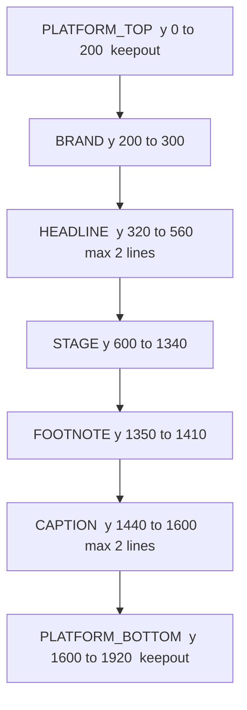

# Layout safe zones

The publish gate for every new video. Numbers live only in `layout/layout_spec.yaml` (version 1.0.0). Scenes are YAML. The solver places them. The renderer draws placed rectangles and nothing else.

## Zones

Reference canvas 1080×1920. Other profiles scale these edges by `width/1080` and `height/1920`, then snap to the 8 px grid. Font floors stay absolute pixels. If a profile cannot fit a floor, the solver raises `LayoutError` instead of shrinking past the floor.



Side margin is 72, so the content width is 936. `RIGHT_RAIL` is x 944–1080, y 1000–1600. It is a keepout, not a content zone. Where that rectangle meets a band, the band's safe region is the band minus the rail. Stage components use that rail-safe column for the whole stage height, so a tall stack cannot enter the rail.

Caption text is centered in the caption safe region (x 72–944), not on the raw canvas center.

| Token | px | Use |
|---|---|---|
| xs, s, m, l, xl | 8, 16, 24, 40, 64 | grid steps |
| sibling_gap | 24 | stacked stage components |
| chip_gap | 16 | chips in one row |
| text_pad_x / text_pad_y | 24 / 16 | type inside a card |
| chip_pad_x / chip_pad_y | 20 / 12 | type inside a chip |
| connector_inflate | 16 | obstacle margin around type |
| tick_gap | 12 | label off a tick |
| center_tolerance | 2 | ink vs slot center |
| max_stack_gap | 64 | largest hole inside the stage stack |
| stroke | 3 | matches the brand stroke |
| underline_h | 8 | headline underline, on the grid |

| Role | Preferred | Floor | Lines |
|---|---|---|---|
| headline | 66 | 64 | 2 |
| caption | 72 | 52 | 2 |
| card title | 36 | 36 | 2 |
| body | 34 | 30 | 3 |
| chip | 32 | 28 | 1 |
| footnote | 26 | 26 | 1 |
| mono / stat | 32 / 64 | 32 / 64 | 4 / 1 |
| brand | 30 | 26 | 1 |

A 72 px caption cannot take two lines inside the 160 px caption band, so the fit ladder steps down by 2 px toward 52. The engine never truncates, ellipsizes, hyphenates, or rewrites the words.

## Rules

Hard failures exit non-zero. LR-10 warns from 45% to 60% stage fill and fails below 45%.

| Id | Fails when | Example | Remedy |
|---|---|---|---|
| LR-01 | Ink or a box leaves its zone, the canvas, or a keepout, including on a later frame | A chip drawn at x 140 with width 390 crosses the rail | Shorten the component or give it its own scene |
| LR-02 | Sibling boxes overlap or sit closer than their gap; glow covers type | Two cards occupy the same band | Separate them. Chips in one row use 16 px; other siblings use 24 px |
| LR-03 | Text or a child leaves its parent box | "built from the box's own date" drawn past the card | Let the card hug the measured text |
| LR-04 | Copy does not fit at the floor, a box is fixed, or the font file is not the bundled one | `COPELAND XWEB` forced into a 200 px chip | Shorten the DSL text or remove a neighbor. Do not add an ellipsis |
| LR-05 | Ink center is more than 2 px off the slot center | Chip text pinned to the chip's center instead of its inner rect | The slot must hug the ink |
| LR-06 | A connector has no route, or a segment crosses text or an icon | A dashed spoke through a pill | Route around the label. No route fails the build |
| LR-07 | A label sits on the icon or card it names | Controller pill drawn on top of the box | Put the label above, below, or beside it |
| LR-08 | A tick label runs past the axis, hits a tick, or crowds the next label | `OCT 2026` past the end of the line | Right-align the last label and keep 12 px off the tick |
| LR-09 | `ILLUSTRATIVE` is not in the footnote and not inside its card | A free-floating disclaimer between cards | Use the footnote line |
| LR-10 | Stage fill under 45%, or a hole taller than 64 px | A small card in an otherwise empty stage | The solver grows decorative bars toward 60%. Below 45% is a hard fail |
| LR-11 | Scale above 1.05, text under a connector, or a cursor with no empty corner | A zoom that leaves its slot | Keep motion inside the slot. One cursor only |
| LR-12 | Contrast under 4.5:1 (3:1 at 64 px and above), or encoded PSNR under 35 | Grey type on the navy field | Use a theme token that clears the ratio |
| LR-13 | More than 6 stage components, 4 chips, 1 overlay, or 3 extra text blocks; a beat under 2.5 s | Four body blocks plus a title | Split the scene in the DSL |
| LR-14 | Stage art or a footnote enters the caption band | A card whose bottom is y 1500 | Keep art above y 1440 |
| LR-15 | A live counter is not monospace, or its slot is narrower than `max_value` | A stat in Poppins | Set `max_value` to the widest string the counter can show |

`LEGACY-UNMIGRATED` is added for any scene the old cairo renderer still draws. The 2026-10-13 episode always carries it.

## Fit ladder

One line, then wrap up to the role's line limit, then shrink by 2 px to the floor, then a wider slot inside the zone, then `alternate` (`vertical` for chips, `stack` for a comparison), then split only when `splittable: true` and each beat stays at least 2.5 s. Otherwise `LayoutError` names the scene, the rule, and the remedy. Nothing is cut.

Connectors are orthogonal routes around text and icons inflated by 16 px, drawn under the type with a background halo. Shared slots are sequential. The default motion is an opacity fade. Scale stays 1 unless the scene sets `scale_to`, and it cannot exceed 1.05.

## Adding a component

1. Add the type name to `layout/schema/scene.schema.json`.
2. Add a builder in `layout/solver.py` that returns placed nodes inside the stage column. Do not accept x, y, width, or a font size from the YAML.
3. Add a portrait template under `layout/templates/` and a stress twin if the component has a long-string failure mode.
4. Run `make test`. The template must have zero hard failures.

## Spec version

Bump `version` in `layout/layout_spec.yaml` when a zone, floor, or gap changes. The loader validates the file against `layout/schema/layout_spec.schema.json` and refuses to start if it does not match. Templates and the showcase must pass the gate again on the new version. A certificate from the previous version is refused by `assert_certified`. Record the bump in `CHANGELOG.md`.

## Run

From `abitinside/`, after `bash setup.sh`:

```bash
make test
make lint
make gate-showcase
make gate-sample
make perf
```

`gate-sample` is expected to exit non-zero. `make gate-sample` succeeds only when the episode is rejected.

One command for a clean checkout that should publish the showcase:

```bash
bash setup.sh && make gate-showcase
```

Drafts land in `out/draft/`. A passing gate atomically replaces `out/publish/<name>/` and writes `layout_certificate.json`. The timestamp is the only field that changes between identical builds. Upload and metadata stamping call `assert_certified` and exit if the certificate is missing or the sha256 does not match the mp4.

## Troubleshooting

Read `out/draft/<name>/layout_report.html`. Each row is a rule id and a remedy. Fix the DSL and run the gate again. Do not edit pixels in the renderer, and do not edit `2026-10-13` to make the sample pass.
